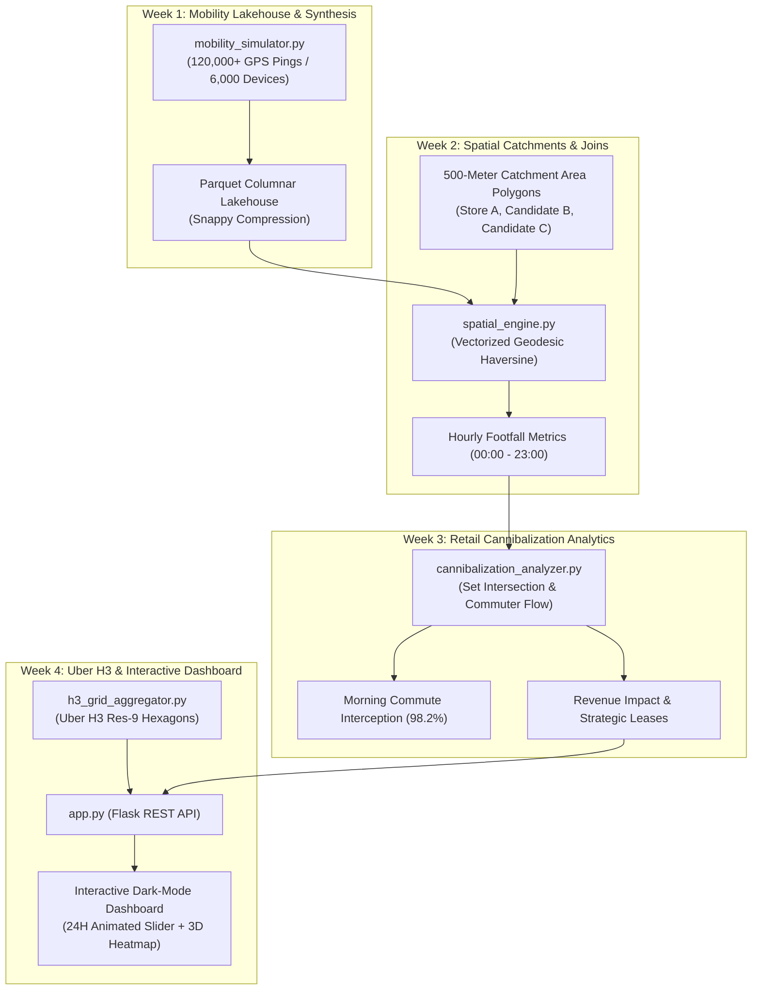

# GeoPulse: Hyper-Local Retail Mobility & Store Cannibalization Analytics


---

## 📌 Executive Overview & Problem Statement

Retail chains frequently make catastrophic multi-million dollar expansion errors by relying on static demographic census tables. Static population numbers fail to capture **dynamic human mobility waves** throughout the day—how people commute, where footfall peaks during lunch, and which transit corridors funnel morning commuters.

As a result, brands often lease a new store location that intercepts and **cannibalizes the footfall and revenue of their existing flagship**, rather than acquiring new customers.

**GeoPulse** is an enterprise-grade Geospatial Mobility Intelligence and Cannibalization Detection platform built for commercial real estate strategists and retail directors (demonstrated on **"UrbanBean Coffee & Roastery"** across the bustling Manhattan commercial and commuter corridor).

---

## 🏗️ System Architecture



---

## 🔍 Key Analytical Findings

| Evaluation Metric | Store A (Wall St Flagship) | Candidate Store B (Fulton Concourse) | Candidate Store C (Flatiron / Madison Sq) |
| :--- | :--- | :--- | :--- |
| **Status** | Existing Operating Flagship | **PROPOSED CANDIDATE 1** | **PROPOSED CANDIDATE 2** |
| **Catchment Buffer** | 500 Meters | 500 Meters | 500 Meters |
| **Unique Daily Patrons** | 3,022 Unique Devices | 3,011 Unique Devices | 2,059 Unique Devices |
| **Overall Cannibalization** | Baseline (0.0%) | **97.0% Overlap** | **4.6% Overlap** |
| **Morning Rush Intercept** | 100% Retained | **98.2% Intercepted (CRITICAL)** | **0.0% (Clean Separation)** |
| **Net-New Patrons Gained** | Baseline | +89 Devices Only | **+1,964 Net-New Devices** |
| **Daily Revenue Cannibalized** | N/A | **-$3,293.00 / day** | **-$98.00 / day** |
| **Strategic Verdict** | **RETAIN FLAGSHIP** | **⛔ REJECT LEASE (CANNIBAL)** | **✅ APPROVE LEASE (GROWTH)** |

---

## 📂 Project Repository Structure

```
Infotact_Second_Project/
├── config.py                         # Geographic bounding box, store definitions & coordinates
├── mobility_simulator.py             # Week 1: High-throughput 120k GPS ping synthesizer
├── spatial_engine.py                 # Week 2: 500m geodesic catchment & vectorized spatial joins
├── cannibalization_analyzer.py       # Week 3: Device-level set intersection & revenue impact model
├── h3_grid_aggregator.py             # Week 4: Uber H3 Res-9 spatial indexing & 24h diurnal layers
├── pipeline_runner.py                # Week 4: Master automated end-to-end pipeline orchestrator
├── app.py                            # Flask web application & REST API server
├── templates/
│   └── index.html                    # Modern interactive dark-mode dashboard with 24h time scrub
├── data/
│   ├── raw_gps_pings.parquet         # Lakehouse columnar GPS records
│   ├── raw_gps_pings.csv             # Raw CSV pings
│   ├── stores.geojson                # Store points with metadata
│   ├── catchment_polygons.geojson    # 500m geodesic circular polygons
│   ├── hourly_footfall.csv           # Hourly aggregate footfall metrics
│   ├── store_footfall_summary.json   # Store summary & peak rush hours
│   ├── cannibalization_results.json  # Mathematical overlap & financial analysis
│   ├── h3_hexagons_24h.json          # 24 individual hourly H3 GeoJSON layers
│   └── h3_hexagons_allday.json       # Cumulative all-day H3 density layer
└── outputs/
    ├── mid_project_spatial_audit.json          # Week 2 Mid-Project Review audit report
    └── cannibalization_executive_report.md     # Week 3 Executive strategy briefing
```

---

## 🚀 Quickstart Guide

### 1. Requirements & Prerequisites
Ensure you have Python 3.10+ installed. Install the necessary geospatial dependencies:
```bash
pip install pandas numpy shapely h3 folium flask pyarrow
```

### 2. Run the Automated End-to-End Pipeline
Execute the master pipeline orchestrator to synthesize data, run spatial joins, calculate cannibalization, and generate H3 hexagons:
```bash
python pipeline_runner.py
```

### 3. Launch the Interactive Mobility Dashboard
Start the local web application:
```bash
python app.py
```
Open your web browser and navigate to:
👉 **`http://127.0.0.1:5000`**

---

## 🌟 Interactive Dashboard Features
1. **24-Hour Diurnal Scrub Slider:** Slide through 00:00 to 23:00 to observe morning commuter rush waves, lunch hotspots, and evening transit dispersals.
2. **Play / Pause Animated Loop:** Automatically animates footfall density waves across the city.
3. **Layer Controls:** Toggle between Uber H3 Hexagonal Density, 500m Catchment Polygons, and Store Locations.
4. **Cannibalization Diagnostic Simulator:** Toggle between Candidate B and Candidate C to view customer overlap rates, morning commuter interception, and revenue dilution metrics.
5. **Multi-Line Trend Chart:** Live Chart.js graph illustrating hour-by-hour unique visitors.

---

## 👤 Developer
* **Lead Engineer:** Sujal Borisa
* **Program:** Infotact Solutions Advanced Data Analytics Internship (Project 2: GeoPulse)
